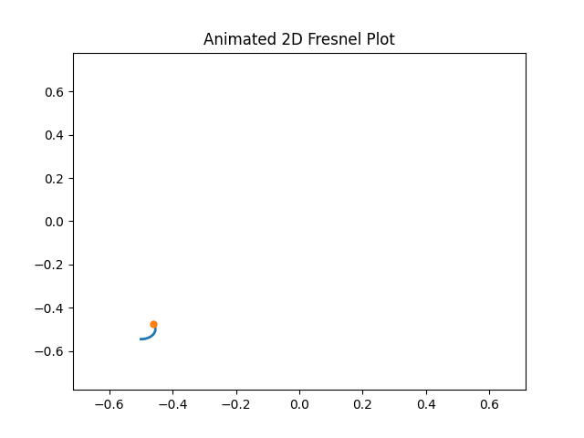
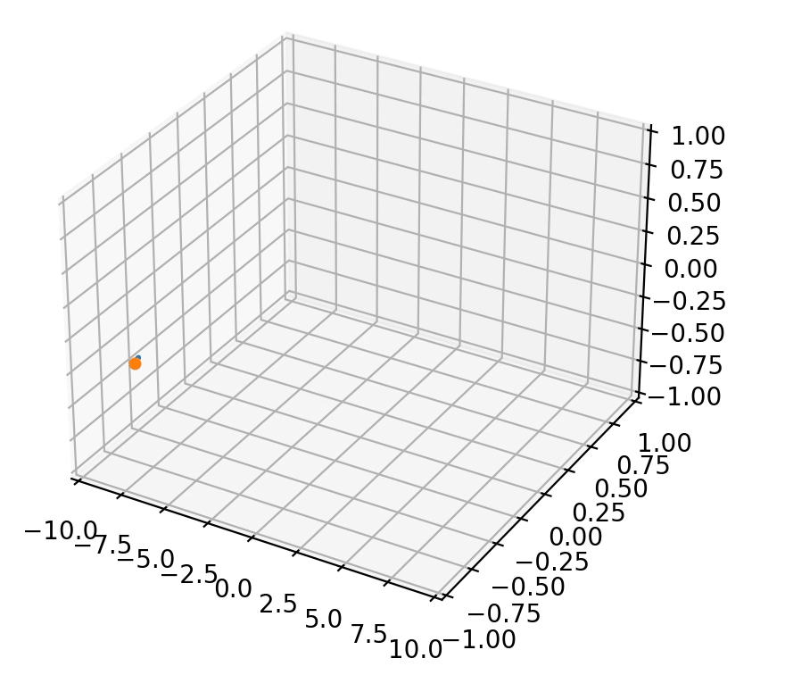

# animplotlib

This package acts as a thin wrapper around the
`matplotlib.animation.FuncAnimation` class to simplify animating `matplotlib`
plots.

<p align="center">
   
</p>

## Installation

Requires Python>=3.10

```
pip install animplotlib
```

Some of the example scripts also require SciPy.

## Quickstart

### Basic 2D animation example

```python
# 2D animated plot of the fresnel integral
from animplotlib import AnimPlot
import numpy as np
import matplotlib.pyplot as plt
import scipy.special as sc

x = np.linspace(-7, 7, 5000)
y, z = sc.fresnel(x)

fig, ax = plt.subplots()
line = ax.plot([], [], lw=2)
point = ax.plot([], [], "o")

ax.set_xlim(np.min(y), np.max(y))
ax.set_ylim(np.min(z), np.max(z))
ax.set_title("Animated 2D Fresnel Plot")

a = AnimPlot(fig, line, point, y, z, plot_speed=2)
a.show()
```

<p align="center">
   
</p>

### Basic 3D animation example

```python
# 3D animated plot of the fresnel integral
from animplotlib import AnimPlot3D
import numpy as np
import matplotlib.pyplot as plt
import scipy.special as sc

x = np.linspace(-7, 7, 1000)
y, z = sc.fresnel(x)

fig = plt.figure()
ax = fig.add_subplot(111, projection="3d")
line = ax.plot([], [], [], lw=1)
point = ax.plot([], [], [], "ro", markersize=5)

ax.set_xlim(np.min(x), np.max(x))
ax.set_ylim(np.min(y), np.max(y))
ax.set_zlim(np.min(z), np.max(z))
ax.set_title("Animated 3D Fresnel Plot")

a = AnimPlot3D(fig, ax, line, point, x, y, z, plot_speed=5)
a.show()
```

<p align="center">
   
</p>

### Saving

```python
a.save("fresnel.gif")
# NOTE: saving as an MP4 requires ffmpeg
a.save("fresnel.mp4", dpi=200)
```

See the API reference for more on saving options.

## 0.2 -> 0.3

v0.3 introduced some fixes and breaking changes. For older animations:

* explicitly call `.show()` to display the figure as it won't open automatically anymore
* `save_as` argument replaced with `.save(path)` method which wraps Matplotlib's saving options
* `l_num` defaults to 0 rather than 10 so the whole line gets drawn

## Documentation

* [API Reference](https://github.com/aymenhafeez/animplotlib/blob/master/docs/API.md)
* [Advanced examples](https://aymenhafeez.github.io/posts/2025-10-09-animplotlib/)

## License

MIT
